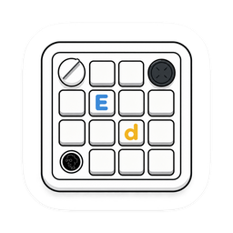

[English](README.md) · [简体中文](public/README.zh-CN.md)

# Ed.Board

**Your Micro. Your workflow.**

A native macOS companion and firmware for AI Micro.
Keys, layers, lighting and an eight-direction joystick, configured in one place.

`macOS 14+` · `Apple Silicon` · `USB + Bluetooth`

[Get started](#get-started) · [Daily use](#daily-use) · [Firmware](#firmware) · [Help](#help) · [Roadmap](#roadmap)

---

## Small board. More control.

| Feature | What you can do |
| --- | --- |
| Actions | Assign shortcuts, mouse wheel and media controls, open apps, files or URLs, and insert text. |
| Layers | Create up to 16 layers, with up to 6 Favorites for touch switching and a searchable Extended list. Inherit actions and match layers to apps. |
| Joystick | Choose actions in eight directions with an optional desktop wheel. Hold a wheel-scroll direction to keep scrolling; return to centre to stop. |
| App Switcher | Hold the knob and turn to choose an open Mac app; release to switch. |
| Appearance | Customize names, icons and layer/key lighting. Import PNG, JPEG, TIFF or SVG icons. |
| Menu bar | Check connection and battery, reopen the editor, or keep Ed.Board running in the background. |

The Codex layer keeps its native knob and joystick behavior.

## Get started

**Requirements:** an Apple Silicon Mac running macOS 14 or later, and an **AI Micro Board3 with ESP32-S3 N16R8** and compatible firmware. Other board revisions are not covered. The App interface is currently English.

### 1. Install

Download the App **DMG** from this repository’s **Releases** page. Open it, drag **Ed.Board.app** onto **Applications**, then eject the image and open the App. Quit the old App before replacing it.

Public builds have no Developer ID signature or Apple notarization. If macOS blocks opening, follow [Apple’s guidance](https://support.apple.com/en-au/102445) for a download you trust. Installation on other Macs still needs verification.

### 2. Connect

- **USB:** use a data-capable cable. If necessary, choose a port under **Settings → Connection → Connect USB**.
- **Bluetooth:** hold the touch area for **3 seconds**, pair **Codex Micro** in macOS Bluetooth settings, allow Ed.Board Bluetooth access, then choose **Connect Bluetooth** in the App.

### 3. Make it yours

Open **Keymap**, choose a layer, then select a key, knob action or joystick direction. Use **Save changes** to apply edits or **Discard changes** to undo them.

- **Layers:** add with **+**, move between Favorites and Extended through **Editing → •••** or the context menu, and link apps for automatic switching. Touch cycles Favorites. Selecting a layer in the editor only selects it for editing; unlinked Extended layers are editing-only.
- **Joystick:** ordinary actions run on return to centre; **Cancel** cancels the selection. The wheel icon beside **Quick Selection** toggles the desktop overlay for that layer without changing its actions.
- **App Switcher:** assign it to the knob’s **Press and hold** in an ordinary layer. Hold for **0.6 seconds**, keep holding and turn clockwise/anticlockwise to select the next/previous app, then release. Short Click and normal turns keep their assigned actions.
- **Icons:** choose an image up to **8 MB**. SVGs display as single-colour icons; other formats keep their colours. The picker remembers your last import folder, and saved icons do not depend on the original files.

## Daily use

Close the window to leave Ed.Board in the menu bar. Enable **System → Launch at Login** for background startup.

Saved shortcuts, mouse/media controls and App Switcher work without Ed.Board running. Opening apps, files or URLs, inserting text, automatic app matching and the desktop wheel need the App. Allow Accessibility access for text insertion. Shortcuts are simultaneous key combinations, not multi-step macros.

Battery percentage is an estimate. Low-battery warnings appear at **15%**, becoming urgent at **5%**. Charge before input becomes unreliable.

## Firmware

Current source: **App 0.6.6 (46) / firmware 0.6.6**. Releases may differ; use the App and firmware supplied together.

For a recognized, compatible keyboard, connect over **USB**, open **System → Device & Firmware**, and follow the update prompt. Close serial monitors and keep USB connected until verification finishes. The updater backs up settings and preserves device identity. Downgrading may require restoring a compatible backup.

This updates compatible devices; it is not a universal factory installer. Do not flash onto another board or bypass compatibility checks.

Inspired by [AI Micro](https://micro.diyshare.cn/); portions of the firmware are adapted from its code, with the original [MIT license and copyright notice](firmware/usb-probe/src/vendor/LICENSE) retained. Its website also provides hardware information and original firmware resources.

## Help

- **macOS connected, App disconnected:** keyboard input and App management use separate connections. Check **Settings → Connection** and retry.
- **Bluetooth fails after a firmware update:** macOS may retain old services. If reconnecting fails, connect by USB, forget **Codex Micro** in macOS, choose **Clear Pairing…** in the App, unplug USB and pair again. Layers are preserved.
- **Input slow to recover after deep sleep:** this intermittent issue remains under investigation. Release all controls and allow time for recovery.
- **Battery unavailable:** check the App connection; a valid reading may not have arrived yet.

Settings and recovery files stay under `~/Library/Application Support/Ed.Board/`; rotating logs are under `~/Library/Logs/Ed.Board/`. Detailed diagnostics stop after 30 minutes.

For bugs or ideas, open an issue with versions, connection type and reproduction steps. Remove personal paths, device identifiers and action content before sharing logs or screenshots.

## Roadmap

Future exploration, guided by community feedback:

- Multi-step macros and other actions.
- Bluetooth pairings with multiple computers.

These are exploratory directions, without a committed release schedule.

## Development & license

See the [development guide](public/DEVELOPMENT.md) to build from source. Original Ed.Board code uses **GPL-3.0-only**; see [LICENSE](LICENSE). Third-party code and assets retain their own terms; see [Third-party notices](public/THIRD_PARTY_NOTICES.md).
